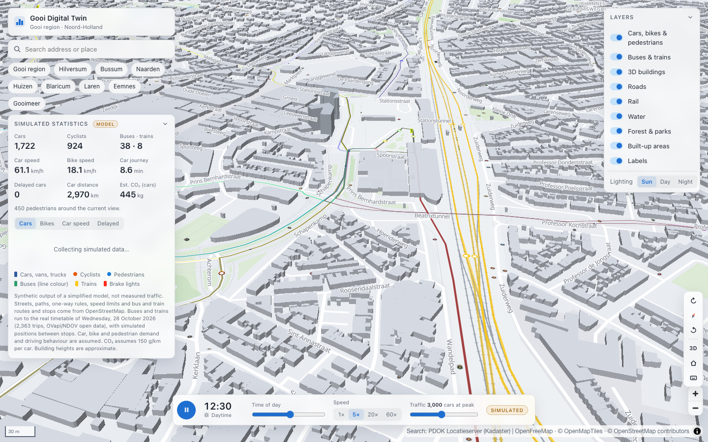
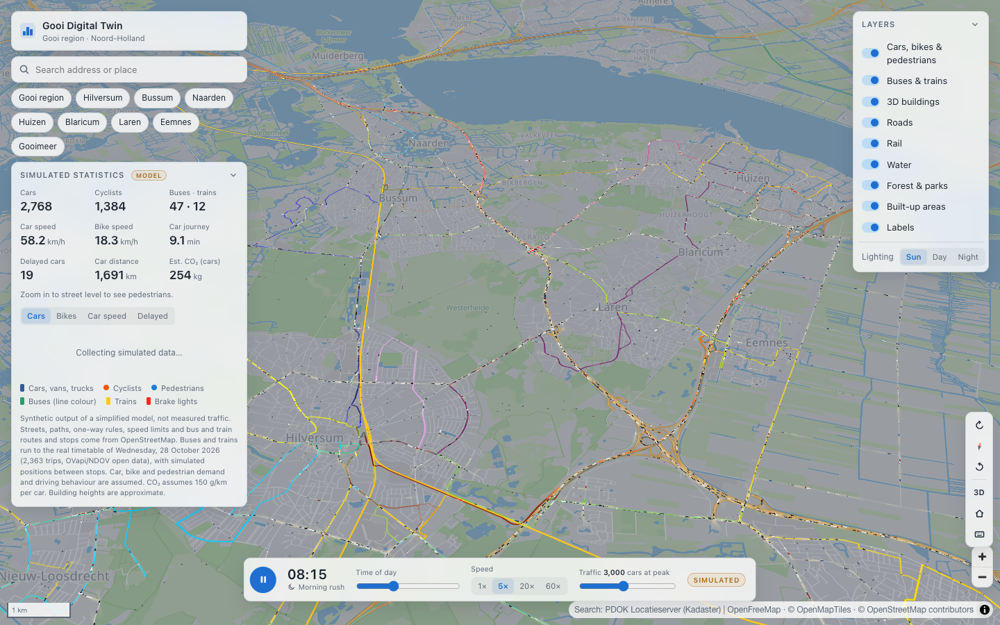
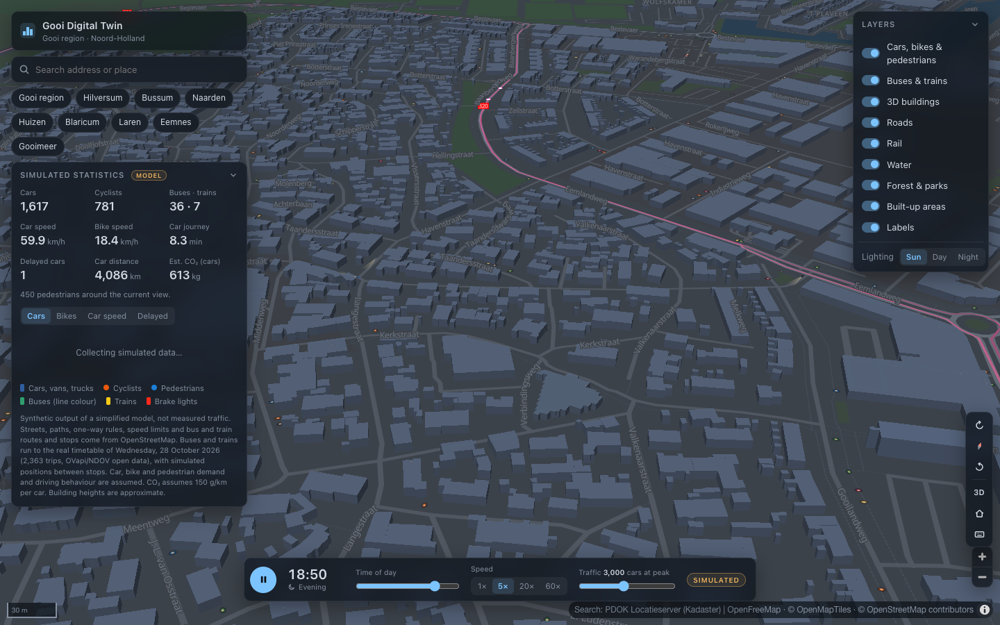

# Gooi Digital Twin

Interactive 3D digital twin and urban mobility simulation of the Gooi region (Hilversum, Bussum, Naarden, Huizen, Blaricum, Laren and Eemnes), Netherlands.

**Live site:** https://teun-sudo1.github.io/gooi-digital-twin/



## Goals

A living geographic model of the Gooi that can be explored in 3D and extended over time:

1. **Real 3D map** of the region (done)
2. **Living city:** clearly labelled *simulated* cars, bikes, pedestrians, buses and trains on the real networks (done)
3. **Interactive infrastructure:** road closures, speed limits, cycle paths, bus lanes and housing scenarios that change the simulation, with the original scenario always restorable (next)

Everything runs in the browser as a static site. There is no backend.

## Features

### Map

- 3D map of the whole Gooi region, with extruded buildings from OpenStreetMap
- **Day and night follow the simulated sun.** The map and interface fade from a light day palette to a dark night palette through twilight, using the sun's real elevation over the Gooi for today's date. Headlights come on after dusk. The layer panel can also force Day or Night.
- Roads, rail, water, forests, parks and Dutch place and street names
- Layer toggles, including **Transit routes & stops**, which only changes the map display: buses and trains keep running
- Rotate buttons (tap or hold), compass, 2D/3D toggle, reset view, keyboard shortcuts (press `?`)
- One-click views of each town; address search through the PDOK Locatieserver
- The camera is kept in the URL, so views can be shared



### Simulated traffic

- **Cars** of five types (hatchback, sedan, SUV, van, truck), each with its own size, colours, acceleration and top speed. Brake lights show when a car slows or stops.
- **Cyclists**, including faster e-bikes, on cycle paths and streets. Contraflow cycling is allowed where OSM tags it.
- **Pedestrians** on footways, pavements and paths, simulated around the area you are viewing at street level
- All modes follow the real street network: about 56,000 street segments from OpenStreetMap, with one-way rules, roundabouts and speed limits
- Cars brake for corners, keep a time gap to the car ahead, and follow Dutch right of way: side roads give way, roundabout traffic goes first, and on equal roads traffic from the right has priority. Queues form on their own.
- Weekday demand profiles per mode, with morning and evening rush hours, plus through traffic on the A1 and A27
- Play/pause, clock and time-of-day scrubber, speed 1–60×, traffic density slider
- A dashboard of **simulated** statistics: cars, cyclists, buses and trains in service, average speeds, car journey time, delayed cars, distance and estimated CO₂, plus a trend chart

### Public transport on real routes and timetables

- **Buses and trains run on their real routes and stops** from OpenStreetMap: Transdev's Gooi lines, R-net 320/321, Hilversum city lines, U-OV and Keolis lines, and NS Intercity and Sprinter services
- **Real timetables:** every trip on a normal weekday comes from the national GTFS feed (2,363 trips). Vehicles pass their stops at the scheduled times, pause at each stop and ease in between. Night buses and seasonal lines don't run on that weekday, so they don't appear.
- Buses carry their line colour and number. Trains are drawn carriage by carriage in NS yellow and blue.



### Keyboard shortcuts

| Key | Action |
| --- | --- |
| `Q` / `E` (hold) | Rotate left / right |
| `N` | Face north |
| `T` | Toggle 2D / 3D |
| `H` | Reset view to the region |
| `Space` | Play / pause simulation |
| `/` | Focus search |
| `?` | Show shortcuts |

## Technology

React 19 · TypeScript · Vite · MapLibre GL JS 6 · Zustand · Web Workers · Vitest · oxlint

The trend chart is a small hand-written SVG component, so no charting library is needed.

## Getting started

Requires Node.js 20.19+ or 22.12+ (`brew install node` on macOS).

```bash
npm install
npm run dev        # http://localhost:5173
```

| Command | What it does |
| --- | --- |
| `npm run dev` | Development server with hot reload |
| `npm run build` | Type-check and build the static site into `dist/` |
| `npm run preview` | Serve the production build at http://localhost:4173/gooi-digital-twin/ |
| `npm test` | Unit tests: routing, traffic model, timetables, sun position |
| `npm run lint` / `npm run typecheck` | oxlint / TypeScript |
| `npm run data` | Rebuild all data files (see below) |

No API keys or environment variables are needed.

## How it works

```
src/
  components/           UI: top bar, search, panels, simulation bar, dashboard, chart
  features/map/         MapLibre map, day/night palettes, sun position, layers, camera, rotation
  features/simulation/  network, routing, traffic and transit models, worker, map client, icons
  features/scenarios/   (milestone 3)
  hooks/ store/ types/ utils/ data/
public/data/            gooi-network.json, gooi-transit.json (generated, committed)
scripts/                fetch-osm.mjs, fetch-timetables.mjs
```

- **Data build (offline).** `scripts/fetch-osm.mjs` downloads all streets and paths in the Gooi from the Overpass API. It splits them at junctions, works out car, bike and foot access in each direction, and keeps each mode's connected network. Roads leaving the area stay connected through a virtual "outside world" node, so through traffic works. It also extracts bus and train route relations, stitching their ways into continuous lines and projecting the stops onto them. `scripts/fetch-timetables.mjs` then streams the national GTFS feed. It matches every trip serving the Gooi to its OSM route variant by line number or train series, stop positions and stop order, and stores the trip's stop times. The outputs are compact (≈1 MB gzipped together) and are committed.
- **Simulation in a Web Worker.** Routing and stepping thousands of agents run off the main thread, so the map stays smooth. About 30 times a second the worker sends the positions of visible agents as a typed array. The main thread draws them through MapLibre GeoJSON symbol layers, with no DOM element per vehicle. React only gets statistics, four times a second.
- **Routing.** Car and bike trips start or end in about 250–400 destination zones per mode. Each zone has a cached shortest-path tree (one Dijkstra, about 4 ms), so a new trip's route is a pointer walk. Pedestrians use A* over short distances.
- **Transit** positions are a pure function of the clock (timetable interpolation), so time jumps are instant.

## Data sources and attribution

| Data | Source | Licence |
| --- | --- | --- |
| Basemap: roads, buildings, water, land use, labels | [OpenStreetMap](https://www.openstreetmap.org/copyright) contributors, via [OpenMapTiles](https://openmaptiles.org/) vector tiles hosted by [OpenFreeMap](https://openfreemap.org/) | ODbL; OpenMapTiles schema CC-BY |
| Street network, bus and train routes and stops | OpenStreetMap contributors, via the [Overpass API](https://overpass-api.de/) | ODbL 1.0 |
| Bus and train timetables | [OVapi GTFS](https://gtfs.ovapi.nl/) (Stichting OpenGeo), from NDOV Loket open data | CC0 1.0 |
| Address and place search | [PDOK Locatieserver](https://www.pdok.nl/) (Kadaster) | Dutch government open data |

OpenFreeMap, Overpass, OVapi and PDOK are free public services, so keep usage reasonable. The data scripts identify themselves and cache downloads in `scripts/.cache/` (git-ignored).

## Known limitations

- **All traffic is simulated.** Car, bike and pedestrian numbers, speeds, journey times, delays and emissions come from a simplified model with assumed demand. They are not observations or predictions of real traffic.
- Buses and trains follow real timetables for one representative weekday (shown in the dashboard), but there is no live data: positions between stops are interpolated, and delays are not modelled. Transit vehicles don't interact with road traffic.
- No traffic lights, lanes, turn restrictions, parking or overtaking. Cars, bikes and pedestrians don't interact with each other.
- Pedestrians are only simulated around a street-level view (zoom 15+).
- CO₂ is a rough estimate (cars only, 150 g/km).
- Vehicles and especially people are drawn larger than true scale when zoomed out, so they stay visible.
- Building heights are approximate where OSM has no height data.

## Roadmap

- [x] Milestone 1: interactive 3D map
- [x] Milestone 2: multimodal simulation, real transit routes and timetables, day/night
- [ ] Milestone 3: road closures that reroute traffic (`TrafficModel.setClosures` and closure-aware routing already exist; UI next), speed limits, cycle paths, bus lanes, pedestrian zones, housing developments, scenario comparison

## Refreshing the data

```bash
npm run data            # streets, transit routes, then timetables (uses cached downloads)
node scripts/fetch-osm.mjs --refresh          # force fresh OSM data
node scripts/fetch-timetables.mjs --refresh   # force a fresh GTFS feed (~240 MB)
node scripts/fetch-timetables.mjs --date 20261104   # use another service day
```

Review the changes to `public/data/`, run `npm test`, then commit.

## Deployment (GitHub Pages)

Every push to `main` runs [.github/workflows/deploy.yml](.github/workflows/deploy.yml). It lints, tests, builds and publishes `dist/` to GitHub Pages. `vite.config.ts` sets the `/gooi-digital-twin/` base path for builds. Status is in the repository's **Actions** tab.

## Saving your work to GitHub

```bash
git status
git add -A
git commit -m "feat: describe the change"
git push                 # publishes and redeploys
```

Never commit `.env` files or credentials. The repository is public.
