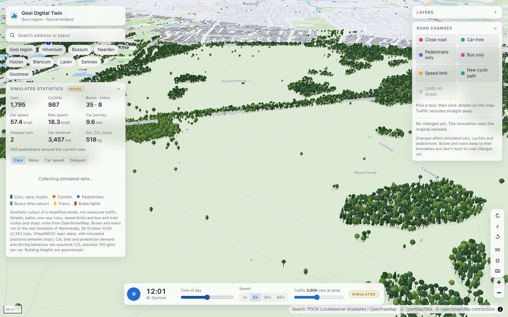
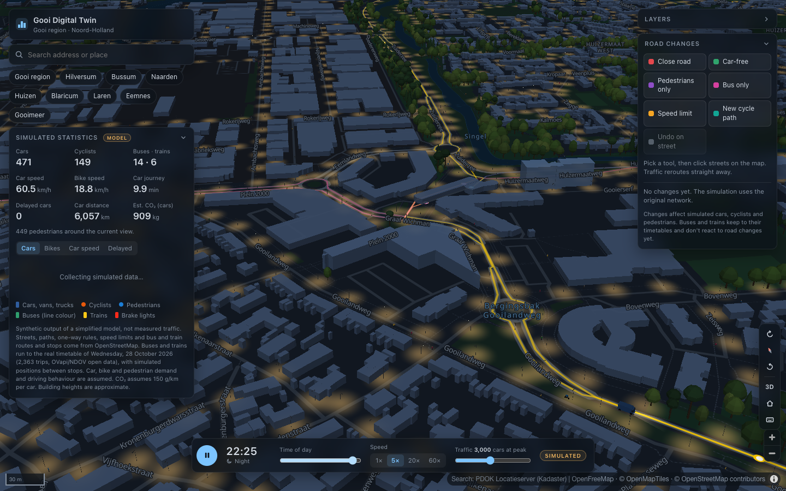
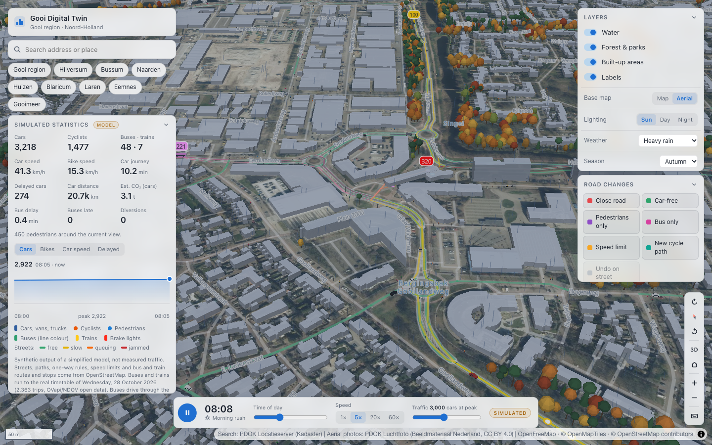
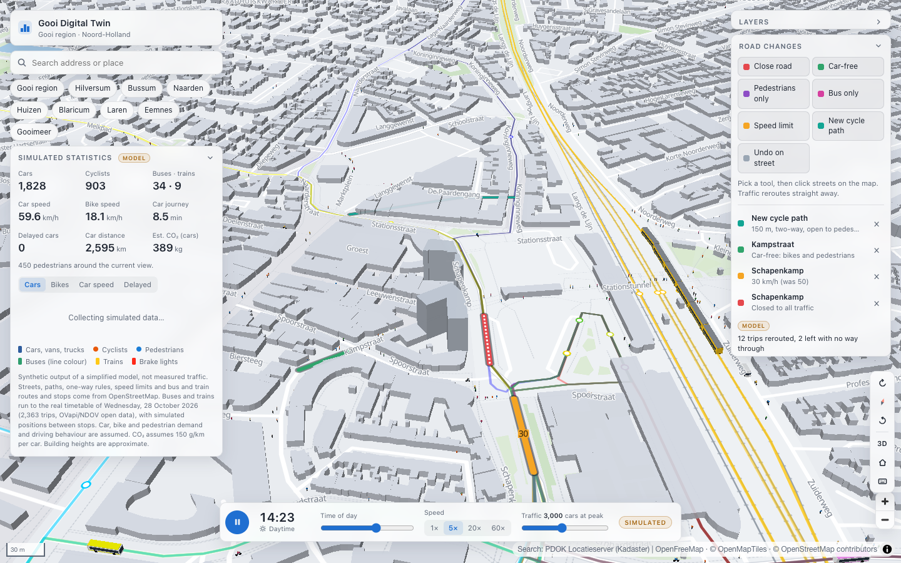
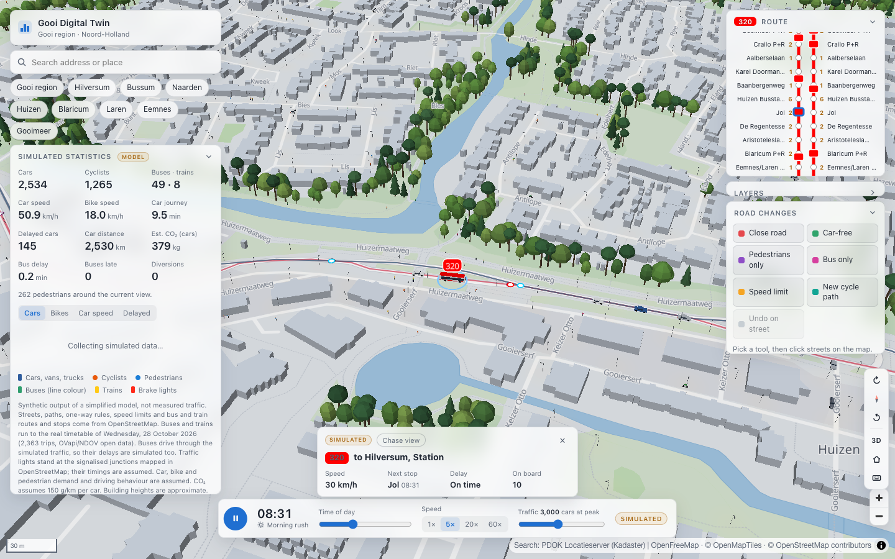

# Gooi Digital Twin

Interactive 3D digital twin and urban mobility simulation of the Gooi region (Hilversum, Bussum, Naarden, Huizen, Blaricum, Laren and Eemnes), Netherlands.

**Live site:** https://teun-sudo1.github.io/gooi-digital-twin/


## Goals

A living geographic model of the Gooi that can be explored in 3D and extended over time:

1. **Real 3D map** of the region (done)
2. **Living city:** clearly labelled *simulated* cars, bikes, pedestrians, buses and trains on the real networks (done)
3. **Interactive infrastructure:** road closures, speed limits, car-free and pedestrian streets, bus-only roads and new cycle paths that change the simulation, with the original network always restorable (done; scenario comparison and sharing next)

Everything runs in the browser as a static site. There is no backend.

## Features

### Map

- 3D map of the whole Gooi region, with extruded buildings from OpenStreetMap
- **Day and night follow the simulated sun.** The map and interface fade from a light day palette to a dark night palette through twilight, using the sun's real elevation over the Gooi for today's date (or the chosen season). Headlights come on after dusk. The layer panel can also force Day or Night.
- **Map modes**, as in map apps: *Explore* (the plain map), *Driving* (busy streets coloured by congestion), *Transit* (bus and train routes and stops) and *Satellite* (aerial photos). They sit at the top of the map panel; the individual layer switches still work underneath.
- **Aerial photos:** the *Satellite* mode shows the latest national aerial photography (PDOK Luchtfoto). Roads, labels and the simulation stay on top, and the photos dim at night.
- **Weather and seasons:** *Live* weather (from Open-Meteo), or choose dry, rain, heavy rain, snow or fog. Rain and snow fall over the map, and the weather changes travel: rain moves cyclists into cars and buses and slows everyone down. The season (today's, or one you choose) colours the trees, from spring blossom to autumn leaves and bare winter branches, tints parks and woods, and sets the sun's path, so winter evenings are dark early.
- Roads, rail, water, forests, parks and Dutch place and street names
- **Trees:** (with an opacity slider in the Layers panel to see streets and traffic underneath) about 90,000 street and park trees at their real positions: the trees and tree rows mapped in OpenStreetMap (9,000+) plus the trees the municipalities record in the BGT (81,000+), and the Gooi's forests and woods filled with oaks, beeches, pines and spruces inside their real OSM outlines (the positions of individual forest trees are illustrative)
- **Street lighting:** lamp posts along lit streets, with warm pools of light on the road after dark; from far away the towns glow. About 150 lamps are mapped in OSM; the other ~34,000 are placed by rule (see [limitations](#known-limitations))
- Layer toggles, including **Transit routes & stops**, which only changes the map display: buses and trains keep running
- One column of camera buttons: rotate (tap or hold), compass, 2D/3D, reset view, zoom and keyboard shortcuts (press `?`)
- One-click views of each town; address search through the PDOK Locatieserver
- The camera is kept in the URL, so views can be shared








### Simulated traffic

- **Every agent is a 3D model** from street level up to zoom 13.5: cars (with glazed cabins, wheels, head- and brake lights), vans, trucks, buses in their line colours, NS train carriages, cyclists and pedestrians. They're drawn in a custom WebGL layer that shares depth with the 3D buildings. Agents are drawn larger than life (1.5× at street level, more when zoomed out), and further out they switch to flat icons.
- **Cars** of five types (hatchback, sedan, SUV, van, truck), each with its own size, colours, acceleration and top speed. Brake lights show when a car slows or stops. Cars keep a safe braking distance to the vehicle ahead (looking past short junction pieces), take turns when two streets merge, and never appear on top of each other.
- **Where trips go:** trips start at homes in proportion to each neighbourhood's population and go to destinations in proportion to its businesses (CBS figures for 2024), with about 15% of trips leaving the region. So Hilversum's centre and business parks attract commuters, and residential areas send them out.
- **Congestion map** (Driving mode): streets where cars are held up (below 40% of the limit for more than 10 s, over at least 12% of their time) are coloured yellow, orange or red; free-flowing streets stay uncoloured.
- **Follow any vehicle:** click a car, bike, pedestrian, bus or train and the camera follows it. A card shows its speed, street, destination, distance left and trip time. For buses and trains it shows the next stop with its scheduled time, the delay, and the (simulated) passengers on board. *Chase view* turns the map with the vehicle; dragging the map or `Esc` stops following.
- **Cyclists**, including faster e-bikes, on cycle paths and streets. Contraflow cycling is allowed where OSM tags it.
- **Pedestrians** on footways, pavements and paths, simulated around the area you are viewing at street level
- All modes follow the real street network: about 56,000 street segments from OpenStreetMap, with one-way rules, roundabouts and speed limits
- Cars brake for corners, keep a time gap to the car ahead, and follow Dutch right of way: side roads give way, roundabout traffic goes first, and on equal roads traffic from the right has priority. Queues form on their own.
- Traffic lights at the 115 junctions where OpenStreetMap maps signals. The corners of a large crossing (two dual carriageways meet in four junction points) form one junction with one controller: vehicles stop only where they enter, and drive straight across. Lights give green by direction, with amber and an all-red clearance; large junctions have a separate left-turn phase. They react to traffic: a green lasts while vehicles keep arriving, directions with nobody waiting are skipped, and a car only enters when there's room past the junction. Cars, bikes on the road and buses stop for red. Signal positions are real; phases and timings are assumed. They're off by default: switch on **Traffic lights** in the Layers panel to use them (switching them off again returns junctions to the right-of-way rules).
- Weekday demand profiles per mode, with morning and evening rush hours, plus through traffic on the A1 and A27
- Play/pause, clock and time-of-day scrubber, speed 1–60×, traffic density slider
- A dashboard of **simulated** statistics: cars, cyclists, buses and trains in service, average speeds, car journey time, delayed cars, distance and estimated CO₂, plus a 24-hour chart of the simulated day against the expected (assumed) demand, with the rush hours shaded

### Road changes (scenarios)

Change the street network on the map and watch simulated traffic adapt:

- **Close road:** nobody can use the street any more
- **Car-free:** cars are banned; cyclists and pedestrians can still use the street
- **Pedestrians only:** walking only (works on streets and cycle paths)
- **Bus only:** cars and bikes are banned (pedestrians keep the pavement)
- **Speed limit:** 30, 50, 60, 80 or 100 km/h. Routes prefer faster streets, so a lower limit also moves traffic elsewhere.
- **New cycle path:** draw a two-way path between two junctions, with bends. It's open to cyclists and pedestrians.
- **Undo on street**, an undo button per change, and **Restore original network**

**Before and after.** At your first change, the simulation forks: a copy keeps running on the original network, in step and with the same demand. The dashboard then compares the two since your last change: car journey time, car speed, share of time delayed, car kilometres and CO₂ per hour, and bus delay. On the map, streets with clearly more car traffic turn orange and streets with less turn blue. Both runs are simulated, and differences of a few percent can be chance.

Pick a tool in the **Road changes** panel, then click streets on the map; the street under the pointer is highlighted first. Clicking a street again with the same tool undoes that change. Changes are drawn on the map in the tool's colour, with the new speed limit as a label.

When the network changes, every trip whose remaining route is no longer allowed is rerouted from the end of the street it is on. New trips plan their routes on the changed network. The panel shows how many trips were rerouted and how many had no way left. Buses divert around closed roads; trains keep to their timetable.



### Public transport on real routes and timetables

- **Buses and trains run on their real routes and stops** from OpenStreetMap: Transdev's Gooi lines, R-net 320/321, Hilversum city lines, U-OV and Keolis lines, and NS Intercity and Sprinter services
- **Real timetables:** every trip on a normal weekday comes from the national GTFS feed (2,363 trips). Vehicles pass their stops at the scheduled times, pause at each stop and ease in between. Night buses and seasonal lines don't run on that weekday, so they don't appear.
- Buses carry their line colour, and a badge with the line number floats above every bus. Trains are drawn carriage by carriage in NS yellow and blue.
- **Buses drive in the simulated traffic.** Each scheduled trip drives its real route and stops at its stops. It never leaves a stop early, and between stops it aims for the scheduled arrival without exceeding the limit. Where the route follows a simulated street (about 70% of route length), the bus queues behind cars and has cars queue behind it. Where a street on the route is closed, it takes the fastest diversion and rejoins the route, skipping the stops in between. Delays build up from all of this and are shown in the dashboard. They are simulated, not live.
- **Route diagram:** while following a bus, a schematic of its whole line appears, with the outbound direction down the left and the return direction up the right. It shows every stop by name (stop names come from the GTFS feed), the passengers waiting at each stop, and every bus on the line; click one to follow it.
- **Passengers are simulated with assumed demand** (there is no ridership data). They arrive at stops at a rate that follows the rush hours and is higher at stops served by several lines and at stations. They board the next bus if there's room (80 places), which makes stops take longer, and get off along the way.
- **Departure boards:** click any stop for the next hour's departures of every bus and train line there. Times come from the timetable, and buses already on their way show their (simulated) delay; click one to follow it. The board also shows the passengers waiting and anyone left behind by a full bus.
- Trains keep exactly to the timetable.




### On phones

Panels move into a dock at the bottom: the simulation controls with tabs for *Stats*, *Roads* and *Layers*, plus *Stop* and *Route* when a stop or bus is open. Tapping a tab opens it as a sheet above the controls.

### Keyboard shortcuts

| Key | Action |
| --- | --- |
| `W` `A` `S` `D` (hold) | Move forward / left / back / right (`Shift` for faster) |
| `Q` / `E` (hold) | Rotate left / right |
| `N` | Face north |
| `T` | Toggle 2D / 3D |
| `H` | Reset view to the region |
| `Space` | Play / pause simulation |
| `/` | Focus search |
| `?` | Show shortcuts |
| `Esc` | Stop following / editing roads / cancel a cycle path |
| `Enter` / `Backspace` | Finish the cycle path / undo its last bend |

## Technology

React 19 · TypeScript · Vite · MapLibre GL JS 6 · Zustand · Web Workers · Vitest · oxlint

The day chart is a small hand-written SVG component, so no charting library is needed.

## Getting started

Requires Node.js 20.19+ or 22.12+ (`brew install node` on macOS).

```bash
npm install
npm run dev        # http://localhost:5173
```

| Command | What it does |
| --- | --- |
| `npm run dev` | Development server with hot reload |
| `npm run build` | Type-check and build the static site into `dist/` |
| `npm run preview` | Serve the production build at http://localhost:4173/gooi-digital-twin/ |
| `npm test` | Unit tests: routing, traffic model, timetables, sun position |
| `npm run lint` / `npm run typecheck` | oxlint / TypeScript |
| `npm run data` | Rebuild all data files (see below) |

No API keys or environment variables are needed.

## How it works

```
src/
  components/           UI: top bar, search, panels, simulation bar, dashboard, chart
  features/map/         MapLibre map, day/night palettes, sun position, layers, camera, rotation
  features/simulation/  network, routing, traffic and transit models, worker, map client, icons
  features/scenarios/   road edits: scenario network, map layers, editing tools
  features/scenery/     trees and street lights: data, 3D models and layer
  hooks/ store/ types/ utils/ data/
public/data/            gooi-network.json, gooi-transit.json, gooi-scenery.json, gooi-demand.json, gooi-signals.json (generated, committed)
scripts/                fetch-osm.mjs, fetch-timetables.mjs, fetch-scenery.mjs, fetch-demand.mjs, fetch-signals.mjs, osm-common.mjs
```

- **Data build (offline).** `scripts/fetch-osm.mjs` downloads all streets and paths in the Gooi from the Overpass API. It splits them at junctions, works out car, bike and foot access in each direction, and keeps each mode's connected network. Roads leaving the area stay connected through a virtual "outside world" node, so through traffic works. It also extracts bus and train route relations, stitching their ways into continuous lines and projecting the stops onto them. `scripts/fetch-timetables.mjs` then streams the national GTFS feed. It matches every trip serving the Gooi to its OSM route variant by line number or train series, stop positions and stop order, and stores the trip's stop times. The outputs are compact (≈1 MB gzipped together) and are committed.
- **Simulation in a Web Worker.** Routing and stepping thousands of agents run off the main thread, so the map stays smooth. About 30 times a second the worker sends the positions of visible agents as a typed array. Close up, the main thread uploads them as instances to a custom WebGL layer (`agentLayer.ts`, one instanced draw call per agent kind, low-poly models in `models.ts`). Zoomed out, they go through MapLibre symbol layers. There are no DOM elements per vehicle, and React only gets statistics, four times a second.
- **Routing.** Car and bike trips start or end in about 250–400 destination zones per mode. Each zone has a cached shortest-path tree (one Dijkstra, about 4 ms), so a new trip's route is a pointer walk. Pedestrians use A* over short distances.
- **Trains** are a pure function of the clock (timetable interpolation), so time jumps are instant. **Buses** (`buses.ts`) are stateful vehicles. At start-up each bus line is matched to the street edges it runs along (sampled every 6 m, snapped by distance and direction), so buses can take part in car-following, and cars can queue behind them.
- **Comparison:** at the first edit the worker forks the traffic model and bus fleet onto the original network and steps both. Each run keeps totals since the last edit (car-seconds, car-km, delayed car-seconds, journeys, bus delay, and cars entering each street), which the worker compares every 1.5 s. It sends the map street geometry once per street.
- **Trees and street lights** are drawn by a second instanced WebGL layer (`sceneryLayer.ts`), but only in 250 m cells near the camera (up to 110,000 trees and 12,000 lamps). Forest cells are generated on demand from the OSM outlines on a jittered 7.5 m grid, a few per frame, and cached. The light pools are a MapLibre circle layer that fades in with the night.
- **Road changes.** The main thread sends the whole scenario (closed or restricted segments, speed limits, new cycle paths) to the worker. The worker rebuilds the network from the original file (about 25 ms), clears the mode bits and changes the speeds of the edited streets, and appends new cycle paths after the original segments, so existing edge ids stay valid. Cached path trees are dropped. Trips whose remaining route is no longer allowed are rerouted a few at a time (at most 6 ms per step). Picking a street under the pointer also happens in the worker, on the original geometry.

## Data sources and attribution

| Data | Source | Licence |
| --- | --- | --- |
| Basemap: roads, buildings, water, land use, labels | [OpenStreetMap](https://www.openstreetmap.org/copyright) contributors, via [OpenMapTiles](https://openmaptiles.org/) vector tiles hosted by [OpenFreeMap](https://openfreemap.org/) | ODbL; OpenMapTiles schema CC-BY |
| Street network, bus and train routes and stops | OpenStreetMap contributors, via the [Overpass API](https://overpass-api.de/) | ODbL 1.0 |
| Traffic signal positions | OpenStreetMap contributors, via the Overpass API (`scripts/fetch-signals.mjs`) | ODbL 1.0 |
| Street and park trees | BGT (Basisregistratie Grootschalige Topografie), vegetation points of type *boom*, via the PDOK OGC API (`scripts/fetch-scenery.mjs`) | CC0 1.0 |
| Trees, forests, street lamps | OpenStreetMap contributors, via the Overpass API (`scripts/fetch-scenery.mjs`) | ODbL 1.0 |
| Population and businesses per neighbourhood | [CBS Kerncijfers wijken en buurten 2024](https://www.cbs.nl/), via PDOK (`scripts/fetch-demand.mjs`) | CC BY 4.0 |
| Aerial photos | [PDOK Luchtfoto](https://www.pdok.nl/) (Beeldmateriaal Nederland) | CC BY 4.0 |
| Live weather | [Open-Meteo](https://open-meteo.com/) (only the Gooi's fixed coordinates are sent) | CC BY 4.0 |
| Bus and train timetables | [OVapi GTFS](https://gtfs.ovapi.nl/) (Stichting OpenGeo), from NDOV Loket open data | CC0 1.0 |
| Address and place search | [PDOK Locatieserver](https://www.pdok.nl/) (Kadaster) | Dutch government open data |

OpenFreeMap, Overpass, OVapi, PDOK and Open-Meteo are free public services, so keep usage reasonable. The data scripts identify themselves and cache downloads in `scripts/.cache/` (git-ignored).

## Known limitations

- **All traffic is simulated.** Car, bike and pedestrian numbers, speeds, journey times, delays and emissions come from a simplified model with assumed demand. They are not observations or predictions of real traffic.
- Buses and trains follow real timetables for one representative weekday (shown in the dashboard), but there is no live data.
- Traffic light phases and timings are assumed, not the real signal plans; there are no pedestrian or cycle light phases of their own (a few junctions get a simple pedestrian phase). No lanes, turn restrictions, parking or overtaking. Cars, bikes and pedestrians don't interact with each other.
- Bus passengers are simulated with assumed demand; there is no ridership data. Bus stretches without a matching simulated street (such as dedicated busways) are driven freely. Bus delays are simulated and don't reflect real punctuality. Trains don't interact with anything.
- The before/after comparison runs both versions with the same demand, so it shows rerouting and congestion effects, not changes in how people choose to travel. While a comparison is running the simulation does twice the work, so at 60× the clock can run slower than requested.
- Pedestrians are only simulated around a street-level view (zoom 15+).
- Road changes work per street segment (junction to junction), and only the model reacts to them: buses keep their timetable, and the demand doesn't change (no one decides to cycle because a road was closed). New cycle paths are straight lines between the points you click and don't cross other streets at grade. Changes are not saved when the page is reloaded.
- CO₂ is a rough estimate (cars only, 150 g/km).
- Road vehicles are drawn up to about 1.5× life size (less for long vehicles), the most that still fits their real spacing; people are enlarged more when zoomed out.
- Trip demand uses CBS population and business counts as weights; the trip rates, rush-hour profiles and the 15% leaving the region are assumptions. Weather effects on travel are assumed too. Live weather is the current weather, even when the simulated clock shows another time.
- Building heights are approximate where OSM has no height data.
- **Scenery is partly illustrative.** Mapped trees and tree rows are at their OSM positions (OSM covers only some street trees), but trees inside forests are placed on a jittered grid within the real outlines. Only about 150 street lamps are mapped in OSM; the rest are placed every 24–40 m along streets tagged as lit, or, without a tag, along urban streets with a limit of 50 km/h or less. Real lamp positions, heights and spacing differ. Trees and lamps are drawn from zoom 14 and 15.

## Roadmap

- [x] Milestone 1: interactive 3D map
- [x] Milestone 2: multimodal simulation, real transit routes and timetables, day/night
- [x] Milestone 3a: road closures, speed limits, car-free, pedestrian and bus-only streets, new cycle paths, with rerouting and restore
- [x] Before/after comparison, buses in traffic, following vehicles, route diagrams with simulated passengers
- [x] Demand from CBS neighbourhood data, congestion map, departure boards and bus capacity, weather and seasons, aerial photos, phone layout
- [ ] Next: housing developments

## Refreshing the data

```bash
npm run data            # streets, transit routes, timetables, trees and lights, then neighbourhood figures (uses cached downloads)
node scripts/fetch-osm.mjs --refresh          # force fresh OSM data
node scripts/fetch-scenery.mjs --refresh      # force fresh trees, forests and lamps
node scripts/fetch-signals.mjs --refresh      # force fresh traffic signal positions
node scripts/fetch-demand.mjs --refresh       # force fresh CBS neighbourhood figures
node scripts/fetch-timetables.mjs --refresh   # force a fresh GTFS feed (~240 MB)
node scripts/fetch-timetables.mjs --date 20261104   # use another service day
```

Review the changes to `public/data/`, run `npm test`, then commit.

## Deployment (GitHub Pages)

Every push to `main` runs [.github/workflows/deploy.yml](.github/workflows/deploy.yml). It lints, tests, builds and publishes `dist/` to GitHub Pages. `vite.config.ts` sets the `/gooi-digital-twin/` base path for builds. Status is in the repository's **Actions** tab.

## Saving your work to GitHub

```bash
git status
git add -A
git commit -m "feat: describe the change"
git push                 # publishes and redeploys
```

Never commit `.env` files or credentials. The repository is public.
