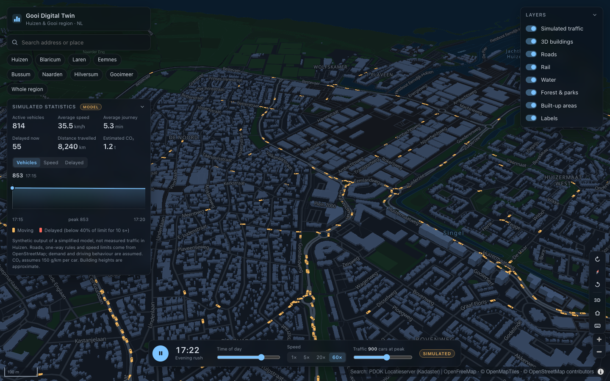
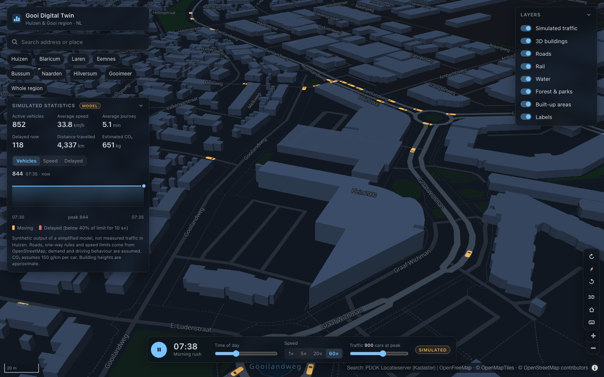
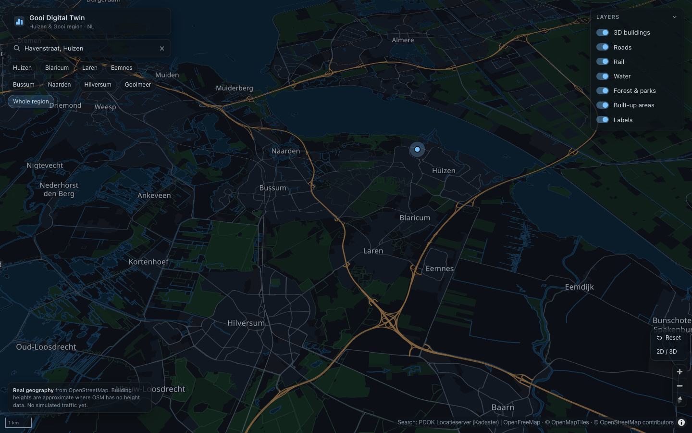

# Gooi Digital Twin

Interactive 3D digital twin and urban mobility simulation of Huizen and the Gooi region, Netherlands.

**Live site:** https://teun-sudo1.github.io/gooi-digital-twin/



## Goals

A living geographic model of Huizen, Blaricum, Laren, Eemnes, Bussum, Naarden, Hilversum and the Gooimeer that can be explored in 3D and extended over time:

1. **Real 3D map** of the region (done: milestone 1).
2. **Living city:** a simplified, clearly labelled *simulated* traffic model on the real road network (done: milestone 2).
3. **Interactive infrastructure:** road closures, speed limits, cycle paths, bus lanes and housing scenarios that change the simulation, with the original scenario always restorable.

Everything runs in the browser as a static site. There is no backend.

## Features

### Map


- Dark 3D map centred on Huizen, limited to the wider Gooi region
- Extruded buildings using OpenStreetMap height data
- Roads by class, rail, water, forests, parks and Dutch place and street labels
- Smooth pan, zoom, pitch and rotate; rotate buttons (tap or hold), compass, 2D/3D toggle and reset camera
- Keyboard shortcuts (press `?` in the app)
- One-click views of every Gooi town and the whole region
- Address and place search through the PDOK Locatieserver, biased towards Huizen
- Collapsible layer panel
- Camera position kept in the URL hash, so views can be shared
- Loading, error and no-WebGL states; works at phone width

### Simulated traffic

- Cars drive on the real drivable road network of Huizen (about 200 km, from OpenStreetMap), following road geometry, one-way streets and roundabouts
- Each car takes the fastest route between an origin and a destination, turning at real junctions
- Speeds follow OSM speed limits with per-driver variation. Cars brake for corners, keep a time gap to the car ahead, and follow Dutch right of way: side roads give way, roundabout traffic goes first, and on equal roads traffic from the right has priority. Queues form on their own.
- A weekday demand profile with morning and evening rush hours. Morning trips mostly leave residential streets for main roads and the edges of town; evening trips return.
- Play/pause, a simulation clock and time-of-day scrubber, playback speed (1×–60×) and traffic density (100–1,500 cars at peak)
- A dashboard of **simulated** statistics: active vehicles, average speed, average journey time, delayed vehicles, distance travelled and estimated CO₂, plus a trend chart
- Delayed cars are shown in red on the map



### Keyboard shortcuts

| Key | Action |
| --- | --- |
| `Q` / `E` (hold) | Rotate left / right |
| `N` | Face north |
| `T` | Toggle 2D / 3D |
| `H` | Reset view to Huizen |
| `Space` | Play / pause simulation |
| `/` | Focus search |
| `?` | Show shortcuts |



## Technology

React 19 · TypeScript · Vite · MapLibre GL JS 6 · Zustand · Vitest · oxlint

The trend chart is a small hand-written SVG component, so no charting library is needed.

## Getting started

Requires Node.js 20.19+ or 22.12+ (`brew install node` on macOS).

```bash
npm install
npm run dev        # http://localhost:5173
```

| Command | What it does |
| --- | --- |
| `npm run dev` | Development server with hot reload |
| `npm run build` | Type-check and build the static site into `dist/` |
| `npm run preview` | Serve the production build at http://localhost:4173/gooi-digital-twin/ |
| `npm run typecheck` | TypeScript only |
| `npm run lint` | oxlint |
| `npm test` | Unit tests for routing and the traffic model (Vitest) |
| `npm run fetch-roads` | Re-download the Huizen road network from OpenStreetMap (see below) |

No API keys or environment variables are needed.

## Project structure

```
src/
  components/        UI: top bar, search, layer panel, camera controls, overlays
  features/map/      MapLibre map, dark style, layer groups, camera helpers
  features/simulation/  Road graph, A* routing, traffic model, map rendering controller
  features/scenarios/   (milestone 3)
  data/              Place presets and region bounds
  hooks/             React hooks: map instance, keyboard shortcuts, simulation lifecycle
  store/             Zustand state: map and layers, simulation controls and statistics
public/data/         huizen-roads.json, the routable road network (generated)
scripts/             fetch-roads.mjs, which builds the road network from OpenStreetMap
  types/             Domain types: geography, roads, vehicles, routes, scenarios
  utils/             PDOK geocoder client
```

Camera movement is handled entirely inside MapLibre, so panning and zooming never re-render React. The traffic model (`engine.ts`) is plain TypeScript with no map or DOM code, so it can be unit-tested. The controller steps it in a `requestAnimationFrame` loop and draws every car through a single GeoJSON symbol layer, with no DOM element per car. React receives throttled statistics about four times a second.

### How the simulation works

1. `scripts/fetch-roads.mjs` queries the Overpass API once for drivable OSM roads in Huizen. It splits them at junctions, applies one-way and roundabout rules, reads `maxspeed` tags (99% of segments have one) and keeps the largest strongly connected network, so every trip can be completed. The result is committed as `public/data/huizen-roads.json` (~160 KB gzipped).
2. In the browser, the network is projected to local metres and turned into a directed graph.
3. Demand: the number of cars follows a stylised weekday profile scaled by the density slider. Origins and destinations depend on the time of day. About 15% of trips are through traffic between the points where main roads leave the modelled area.
4. Routing: A* on free-flow travel time.
5. Driving: each car accelerates towards its preferred speed and brakes for corners, junctions where it must give way, its destination, and the car ahead (time-gap following). Cars below 40% of the speed limit for over 10 simulated seconds count as delayed.

To refresh the road data: `npm run fetch-roads`, review the diff, then commit.

## Data sources and attribution

| Data | Source | Licence |
| --- | --- | --- |
| Roads, buildings, water, land use, labels | [OpenStreetMap](https://www.openstreetmap.org/copyright) contributors, via [OpenMapTiles](https://openmaptiles.org/) vector tiles hosted by [OpenFreeMap](https://openfreemap.org/) | ODbL (data), OpenMapTiles schema (CC-BY) |
| Road network for the simulation | [OpenStreetMap](https://www.openstreetmap.org/copyright) contributors, via the [Overpass API](https://overpass-api.de/) | ODbL 1.0 |
| Address and place search | [PDOK Locatieserver](https://www.pdok.nl/) (Kadaster: BAG, BRT) | Dutch government open data (CC0 / CC BY 4.0) |

Attribution is shown in the map's attribution control. OpenFreeMap and PDOK are free public services, so please keep usage reasonable.

## Known limitations

- **Building heights are approximate.** They come from OSM `height` and `building:levels` tags. Where neither exists, the tile generator uses a small default height. No heights are invented by this app, but the defaults are not surveyed values.
- Building footprints and roads are as complete as OpenStreetMap is.
- Vector tiles stop at zoom 14 and are overzoomed beyond that, which is fine for buildings and roads.
- The Netherlands is flat, so there is no terrain elevation model.
- **All traffic is simulated.** Vehicle counts, speeds, journey times, delays and emissions come from a simplified model with assumed demand. They are not observations or predictions of real traffic in Huizen.
- The model has no traffic lights, lanes, turn restrictions, parking, buses, bicycles or pedestrians. Junctions use simple give-way rules.
- Traffic is modelled only inside Huizen. Cars enter and leave where main roads cross the edge of the area.
- CO₂ is a rough estimate: distance × an assumed 150 g/km per car.
- Cars are drawn larger than true scale when zoomed out, so they stay visible.

## Roadmap

- [x] Milestone 1: interactive 3D map of Huizen and the Gooi region
- [x] Milestone 2: road graph from OSM, animated vehicles, simulation clock, time-of-day demand, dashboard of simulated statistics
- [ ] Milestone 3: road closures that reroute traffic (the engine already supports closures and rerouting; UI to follow), speed limits, cycle paths, bus lanes, pedestrian zones, housing developments, scenario comparison

## Deployment (GitHub Pages)

Every push to `main` runs [.github/workflows/deploy.yml](.github/workflows/deploy.yml). It lints, tests, builds and publishes `dist/` to GitHub Pages with the official Pages actions.

- `vite.config.ts` sets the base path to `/gooi-digital-twin/` for builds, so assets load from the repository sub-path. The dev server still uses `/`.
- One-time setup (already done for this repo): **Settings → Pages → Build and deployment → Source: GitHub Actions**.
- Deployment status is in the repository's **Actions** tab. You can also rerun it manually there with **Run workflow**.

## Saving your work to GitHub

```bash
git status                     # see what changed
git add -A                     # stage changes (.env files are ignored)
git commit -m "feat: describe the change"
git push                       # publishes to GitHub and triggers a redeploy
```

Use short, descriptive commit messages such as `feat: add vehicle simulation` or `fix: search on mobile`. Never commit `.env` files or credentials. Because the repository is public, everything you push is visible to anyone.
